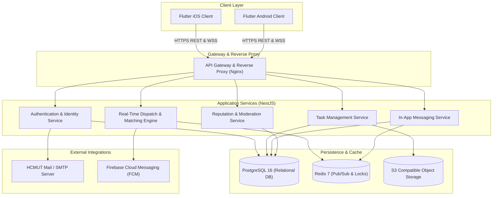
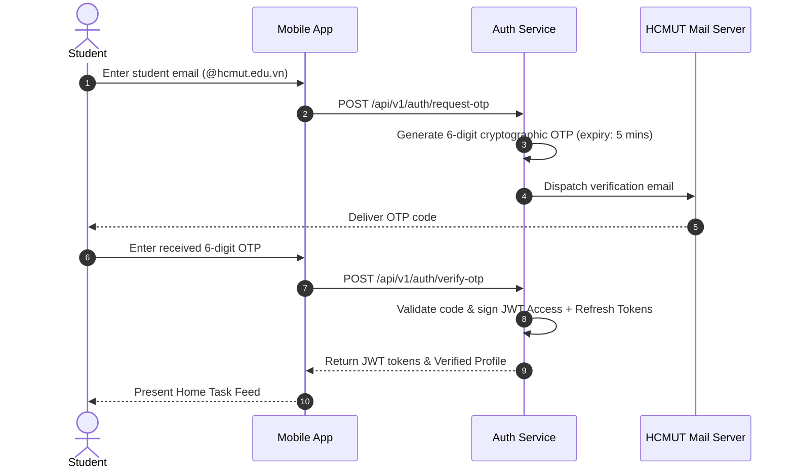
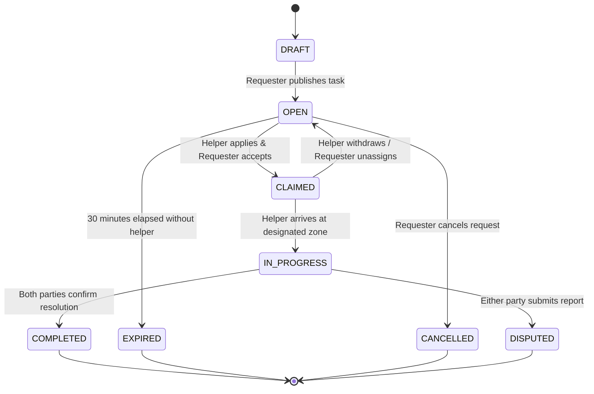
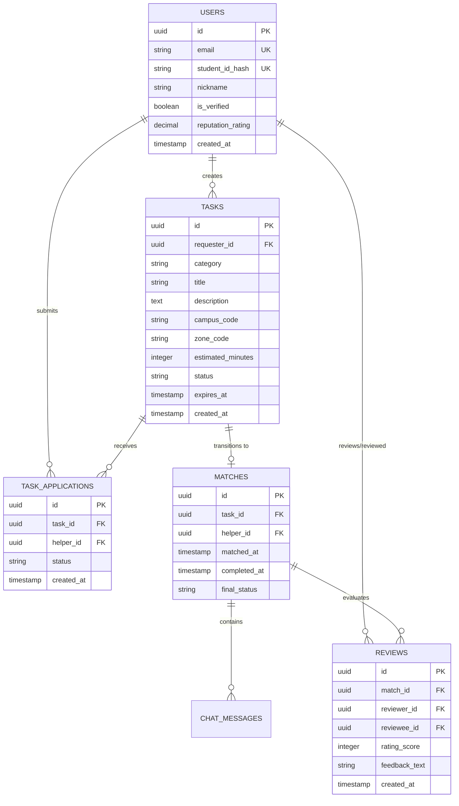
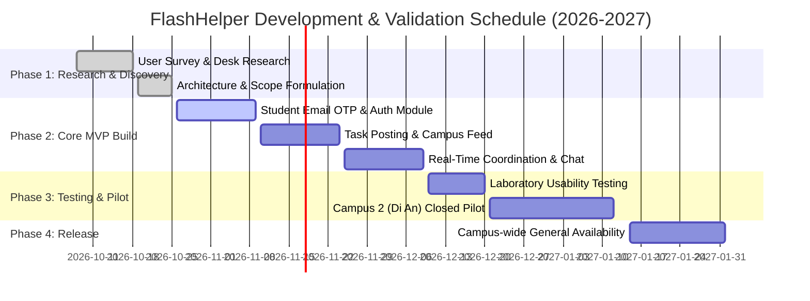

# FlashHelper
Wikidoc about the app

# Research & Validation

## 1. Overview

FlashHelper is a proposed mobile application that helps students at Ho Chi Minh City University of Technology (HCMUT) connect with other students who can provide assistance with everyday tasks on campus.

The purpose of this research is to understand students' current help-seeking behaviors, identify barriers to finding assistance, evaluate existing alternatives, and determine which product features should be prioritized for the Minimum Viable Product (MVP).

This document combines primary research from a student survey with a preliminary analysis of existing alternatives. Product decisions are provisional and may change as additional evidence becomes available.

### Research Objectives

- Understand the situations in which students need help on campus.
- Identify the limitations of current help-seeking methods.
- Investigate students' concerns about trust, privacy, and safety.
- Analyze at least five existing alternatives.
- Translate research findings into evidence-based product decisions.

## 2. User Research

### 2.1. Research Method

The team conducted an online questionnaire to investigate students' experiences, preferences, and concerns regarding peer-to-peer assistance on campus.

| Item | Description |
|---|---|
| Research method | Online questionnaire |
| Number of responses | 20 |
| Data collection period | October 8–18, 2026 |
| Main target group | HCMUT students |
| Research focus | Help-seeking behavior, current alternatives, trust, privacy, and product preferences |

The questionnaire included questions about previous experiences, current ways of finding assistance, difficulties encountered, willingness to help other students, and expected features of a dedicated platform.

### 2.2. Participant Profile

| Participant characteristic | Responses | Percentage |
|---|---:|---:|
| HCMUT students | 19 | 95% |
| Students from other VNU-HCM universities | 1 | 5% |
| Fourth-year students | 14 | 70% |
| Third-year students | 4 | 20% |
| Second-year students | 2 | 10% |
| **Total** | **20** | **100%** |

The sample primarily represents senior HCMUT students. Therefore, the findings are useful for initial product discovery but should not be generalized to all university students without further research.

### 2.3. Key Findings

#### Finding 1: Students experience difficulties finding assistance

- 13 out of 20 respondents (65%) reported that they occasionally or frequently needed help on campus.
- 10 respondents (50%) reported that finding assistance typically took between 15 minutes and one hour.
- 5 respondents (25%) reported that it took several hours.
- 1 respondent (5%) reported that finding assistance was very difficult or sometimes unsuccessful.

Overall, 16 respondents (80%) reported that finding assistance took at least 15 minutes or was very difficult.

**Implication:** FlashHelper should investigate whether a dedicated, centralized platform can reduce the time and effort required to find an available helper.

#### Finding 2: Students primarily rely on existing personal relationships

The most common first point of contact was close friends, selected by 13 respondents (65%). Another 6 respondents (30%) selected classmates or people taking the same course.

Current channels included:

- Direct messages to friends and acquaintances: 19 respondents (95%).
- Asking people physically nearby: 7 respondents (35%).
- Posting in university or faculty Facebook groups: 5 respondents (25%).
- Class or cohort group chats on Zalo or Discord: 1 respondent (5%).

Respondents could select multiple channels.

**Implication:** FlashHelper should not simply duplicate existing messaging applications. Its potential value lies in helping students discover available helpers beyond their immediate social circles.

#### Finding 3: Uncertainty and social discomfort discourage public requests

When asked what made them hesitant to post public help requests:

- 13 respondents (65%) selected uncertainty about receiving a useful response.
- 8 respondents (40%) selected fear of being judged.
- 8 respondents (40%) selected concerns about personal information exposure.
- 7 respondents (35%) selected concern about disturbing other members of a shared group.

These findings suggest that students may need a more structured and comfortable way to request help.

**Implication:** The product should make requests easy to create, show their status clearly, and provide a controlled way to communicate without requiring users to publish personal details publicly.

#### Finding 4: Trust and privacy are important adoption considerations

When asked about the most important feature of a dedicated HCMUT platform:

| Feature | Responses | Percentage |
|---|---:|---:|
| HCMUT student account verification | 10 | 50% |
| Location-based matching | 5 | 25% |
| Reputation or post-task ratings | 4 | 20% |
| Notifications about nearby requests | 1 | 5% |

Regarding identity display:

- 12 respondents (60%) preferred anonymity combined with verified HCMUT student status.
- 5 respondents (25%) preferred a nickname.
- 3 respondents (15%) preferred their real names.

The main concerns about using a platform to connect with unfamiliar students included personal information exposure, personal safety during face-to-face interactions, fraudulent accounts, and the possibility of others taking advantage of their willingness to help.

**Implication:** Student verification, privacy controls, and a basic reputation mechanism deserve consideration before advanced features.

Verification should establish eligibility to participate without automatically exposing a user's real name, phone number, or other private information.

#### Finding 5: Location sharing should remain under user control

Regarding location sharing:

- 13 respondents (65%) were willing to share their approximate location only when they needed help or wanted to help someone.
- 5 respondents (25%) were willing to share their location.
- 2 respondents (10%) did not want to share their location for privacy reasons.

**Implication:** Location-based matching may provide value, but continuous location tracking should not be assumed to be acceptable.

The initial product should consider optional, task-specific sharing of approximate campus location rather than requiring permanent location access.

#### Finding 6: Willingness to help depends on practical constraints

When asked whether they would help another student:

- 10 respondents (50%) said their decision would depend on their availability and the task.
- 7 respondents (35%) said they were willing to help whenever the task was within their capabilities.
- 3 respondents (15%) said they would only help people they knew.

In addition, 18 respondents (90%) reported that when they could not find assistance, they generally tried to handle the problem themselves.

**Implication:** FlashHelper should make it easy to understand a task's expected duration, difficulty, and location before accepting it. Matching should account for helpers' availability rather than assuming that nearby students are always willing to help.

### 2.4. Research Limitations

The survey provides useful initial signals but has several limitations:

1. **Small sample size:** The survey contains only 20 responses.
2. **Limited demographic coverage:** 95% of respondents are HCMUT students, and 70% are fourth-year students.
3. **Self-reported behavior:** Responses describe participants' recollections and preferences rather than directly observed behavior.
4. **Hypothetical product evaluation:** Perceived usefulness does not establish actual adoption or continued usage.
5. **Limited behavioral validation:** The survey does not measure actual response times, successful matching rates, or repeat usage.
6. **Potential selection bias:** The recruitment process may have attracted students who were already interested in peer assistance.

The results should therefore be treated as preliminary evidence rather than definitive validation of the product.

### 2.5. Further Research

The next research phase should include:

- Interviews with students from different year levels and faculties.
- Interviews with students who are willing to help, not only students seeking assistance.
- Investigation of recent, concrete situations in which students could not find help quickly.
- Prototype testing to observe whether students can create requests and identify suitable helpers.
- A small pilot to measure response time, successful matches, task completion, and repeat usage.

The team should pay particular attention to whether students would use a dedicated application instead of their existing social networks.

## 3. Existing Solutions and Alternatives

FlashHelper operates in a space where students already have several ways to find assistance. These alternatives include service marketplaces, household-service platforms, and general-purpose community or messaging tools.

The following comparison is an initial desk-research assessment. It describes the general purpose of each alternative and identifies questions the team should investigate further. It does not represent a completed hands-on usability test or a verified comparison of every feature.

### 3.1. Taskrabbit

**Website:** https://www.taskrabbit.com/

Taskrabbit connects customers with people offering local services, including household tasks and other practical assistance.

**Strengths**
- Provides a dedicated environment for finding people to perform tasks.
- Focuses on matching customers with service providers.
- Offers a more task-oriented experience than a general-purpose social network.

**Limitations for FlashHelper's target context**
- Its service-marketplace model differs from informal, student-to-student assistance.
- Its suitability for small, spontaneous, campus-specific requests requires further investigation.
- Its operating availability and service model may not match the HCMUT student community.

**Opportunity for FlashHelper:** Focus on campus-specific requests, peer assistance, and low-friction coordination rather than attempting to reproduce a general service marketplace.

### 3.2. Airtasker

**Website:** https://www.airtasker.com/

Airtasker allows users to post tasks and connect with people who may be able to complete them.

**Strengths**
- Uses a task-centered workflow.
- Provides a relevant reference for task descriptions and the process of accepting work.
- Demonstrates an alternative to searching through personal contacts.

**Limitations for FlashHelper's target context**
- Its broader task marketplace is not specifically designed around verified HCMUT students.
- The suitability of its task and payment model for informal campus assistance needs further investigation.

**Opportunity for FlashHelper:** Simplify the process for small campus tasks and prioritize student identity verification and contextual matching.

### 3.3. bTaskee

**Website:** https://www.btaskee.com/

bTaskee provides household services through a dedicated service platform.

**Strengths**
- Offers a structured way to request household assistance.
- Provides a useful reference for service requests and the coordination of in-person work.
- Is relevant to the Vietnamese market.

**Limitations for FlashHelper's target context**
- Its household-service focus differs from the broader range of student needs, such as directions, finding classrooms, borrowing study materials, or collecting items.
- A professional service model may not be suitable for every informal peer-to-peer request.

**Opportunity for FlashHelper:** Focus on lightweight, everyday student needs that may not justify booking a conventional service.

### 3.4. Facebook Groups

**Website:** https://www.facebook.com/groups/

Students can post requests in university, faculty, or student community groups.

**Strengths**
- Students may already participate in relevant communities.
- Posting can reach people beyond immediate personal contacts.
- Existing groups reduce the need to introduce an entirely new communication channel.

**Limitations**
- Requests may compete with unrelated posts.
- Public requests can expose students to unwanted attention or judgment.
- A requester may not know whether anyone is available to help.
- Finding an appropriate response may require manual follow-up.

These limitations are hypotheses to validate through further observation of actual student groups.

**Opportunity for FlashHelper:** Organize requests by task, location, availability, and status, while limiting unnecessary public exposure.

### 3.5. Zalo and Messenger

**Websites:**
- https://zalo.me/
- https://www.messenger.com/

Students use messaging applications to contact friends, classmates, and other acquaintances directly.

**Strengths**
- Familiar communication workflows.
- Direct conversations make it easy to clarify details.
- Existing social relationships can provide an initial basis for trust.

**Limitations**
- Finding an available helper depends heavily on whom the requester already knows.
- Requests may need to be sent to multiple contacts.
- Messages do not inherently create a shared, searchable directory of available helpers for a campus community.

The extent of these limitations depends on how each student currently uses messaging groups and contacts.

**Opportunity for FlashHelper:** Help users discover potential helpers first, then provide a clear and controlled way to communicate and coordinate.

### 3.6. Comparative Summary

| Alternative | Primary strength | Potential gap for FlashHelper's context |
|---|---|---|
| Taskrabbit | Local task and service matching | Student-specific community and informal campus requests |
| Airtasker | Task posting and task-provider discovery | Verified, campus-focused peer assistance |
| bTaskee | Structured household-service requests | Small, diverse, informal student tasks |
| Facebook Groups | Existing community reach | Structured matching, request status, and privacy controls |
| Zalo / Messenger | Familiar direct communication | Discovering available helpers outside existing contacts |

These alternatives should not be interpreted as having no relevant capabilities. The comparison identifies potential opportunities for differentiation, not proven competitive advantages.

### 3.7. Research Implications

Three areas deserve further investigation:

1. **Discovery:** Can FlashHelper help students find an available and suitable helper more efficiently than their current methods?
2. **Trust:** Does verified student participation increase willingness to request or provide assistance?
3. **Convenience and privacy:** Can students coordinate small tasks without publishing unnecessary personal information or sharing their location continuously?

FlashHelper should not attempt to compete with established platforms on the breadth of services. Its proposed differentiation is a focused, student-centered experience for campus assistance.

## 4. Evidence-Based Product Decisions

The following decisions connect the current survey evidence to the proposed product direction. They remain provisional because the survey is small and the product has not yet been validated through a live pilot.

| Product assumption or question | Evidence | Decision | Product implication |
|---|---|---|---|
| Students experience difficulty finding assistance | 16/20 reported needing at least 15 minutes or finding it very difficult to find help | Keep | Continue investigating faster discovery and matching |
| Students need a dedicated student community | 19/20 respondents were HCMUT students, but most already rely on personal contacts | Investigate further | Test whether a dedicated platform provides enough value beyond existing groups |
| Student verification is important | 10/20 selected verification as the most important feature | Keep | Prioritize a feasible student-verification approach |
| Public identity exposure may discourage requests | 12/20 preferred anonymity with student verification; 5/20 preferred a nickname | Keep | Provide controlled identity display and minimize public personal information |
| Location-based matching is useful | 5/20 selected location-based matching as the most important feature; 13/20 preferred conditional location sharing | Revise | Make approximate location sharing optional and task-specific |
| Ratings can improve trust | 4/20 selected post-task reputation ratings as the most important feature | Investigate further | Consider basic feedback after completion; test whether ratings improve trust |
| Students will always be available to help | 10/20 said willingness depends on availability and task requirements | Reject | Do not assume nearby users are available; let helpers choose whether to accept requests |
| Students will adopt a dedicated app | 14/20 rated the proposed idea 4 or 5 out of 5 | Investigate further | Test actual request creation, response, and repeat usage before claiming adoption |
| Advanced functionality is needed from the start | Respondents identified privacy and complexity as barriers | Revise | Keep the MVP small and easy to use |

### 4.1. Current Product Direction

Based on the available evidence, FlashHelper should initially focus on the following value proposition:

**Help HCMUT students find and coordinate peer assistance for everyday campus tasks through a simple, privacy-conscious, student-focused platform.**

The initial product direction should prioritize:

- A clear workflow for creating and browsing help requests.
- Student identity verification or another credible way to establish community membership.
- Basic task information, including location, expected effort, and relevant requirements.
- A way for helpers to indicate interest and for requesters to coordinate with them.
- User-controlled communication and location sharing.
- Basic safeguards against inappropriate behavior and misuse.

These are proposed priorities, not a claim that every capability has already been implemented or validated.

### 4.2. Decisions Deferred Until Further Evidence

The team should avoid committing to the following until additional research supports them:

- Continuous background location tracking.
- A complex rewards or points system.
- Monetary payments as a core requirement for every task.
- Advanced reputation algorithms.
- A large number of independent task categories.
- A guarantee that every request will receive a response within a fixed period.

The MVP should test the central assumption that students can successfully find and coordinate with suitable helpers through a dedicated campus platform.

## 5. MVP Validation Plan

The next stage should test whether the proposed workflow creates measurable value.

| Hypothesis | Validation method | Suggested measure |
|---|---|---|
| Students can create requests without difficulty | Moderated prototype usability test | Task completion and observed difficulties |
| A dedicated platform improves helper discovery | Compare pilot experiences with current methods | Time to first suitable response |
| Students are willing to accept requests from verified peers | Small campus pilot | Acceptance rate |
| Requests can lead to successful assistance | Track completed requests | Completion rate |
| Privacy controls make users comfortable | Usability testing and follow-up interviews | Reported concerns and observed abandonment |
| The platform provides value beyond existing channels | Follow-up interviews and repeat-use observation | Repeat usage and reasons for choosing FlashHelper |

The team should define measurement rules before the pilot. For example, a successful match should require a suitable helper to respond and the requester to confirm that the response is relevant.

A small pilot can provide directional evidence, but it should not be presented as proof of broad market demand.

## 6. Traceability: Evidence to Product Decisions

The research should connect directly to subsequent design and implementation work.

| Evidence | User need | Proposed requirement | Candidate MVP feature |
|---|---|---|---|
| Finding available assistance can take time | Discover suitable helpers efficiently | Requests and potential helpers must be easy to discover | Help-request feed |
| Students rely on personal contacts | Reach people beyond existing relationships | Requests should be visible to eligible community members | Campus request browsing |
| Student verification is a leading feature preference | Establish community trust | The platform should provide a credible verification mechanism | Student verification |
| Many respondents prefer controlled identity display | Request assistance without unnecessary exposure | Personal details should not be publicly exposed by default | Privacy and identity settings |
| Location sharing is usually conditional | Find nearby assistance without continuous tracking | Users should control when location is shared | Optional approximate location |
| Helpers consider time and task difficulty | Understand the commitment before accepting | Requests should describe task details and expected effort | Task details and acceptance flow |

Each proposed feature should be converted into a user story and a development task only when it is included in the agreed MVP scope.


## 7. Campus Task Taxonomy & Representative Scenarios

Building on Findings 1 and 6 regarding the nature of campus assistance, student tasks at Ho Chi Minh City University of Technology (HCMUT) exhibit high contextual specificity. To support intuitive categorization and fast matching in the MVP, tasks are organized into five primary functional domains:

| Category | Example Scenarios at HCMUT | Typical Commitment | Urgency Level |
|---|---|---|---|
| **Academic Hardware & Study Tools** | Borrowing a display adapter (USB-C/HDMI) before a presentation in Building B4 or H6; borrowing a scientific calculator (Casio fx-580VN); breadboard/jumper wires during lab sessions. | 5–15 minutes | High |
| **Physical Logistics & Campus Errand** | Assistance carrying heavy project models or laboratory apparatus between Building A4 and C6; borrowing an umbrella during sudden afternoon rain at Di An campus. | 10–20 minutes | Medium |
| **Wayfinding & Room Orientation** | Locating obscure laboratory sub-rooms (e.g., specialized rooms in Building H6 at Campus 2 or older annexes at Campus 1); finding specific faculty offices for document submission. | 5–10 minutes | Medium |
| **Emergency & Roadside Incidents** | Flat motorbike tire or drained battery at Student Parking Lot B6 (District 10) or Di An Dormitory parking; locating misplaced student ID cards or keys. | 10–25 minutes | High |
| **Temporary Item Guarding** | Watching a study desk or personal backpack at the Central Library during a short 10-minute administrative errand or restroom break. | 5–15 minutes | Low |

---

## 8. Target User Personas

To translate the survey findings into user-centric product requirements, two representative personas were developed based on the respondent profile and behavioral patterns.

### Persona 1: The Time-Constrained Requester

```
┌────────────────────────────────────────────────────────────────────────┐
│ Nguyen Van Minh — 2nd-Year Computer Science Student                   │
│ Primary Campus: Campus 2 (Di An, Binh Duong)                          │
├────────────────────────────────────────────────────────────────────────┤
│ • Context: Has a seminar presentation in 20 minutes at Building H6.    │
│   Realizes he forgot his USB-C display adapter at the dorm.            │
│ • Friction & Frustrations:                                             │
│   - His closest classmates are currently attending lectures elsewhere. │
│   - Hesitant to post on large Facebook groups due to spam and judgment.│
│   - Waiting for message replies in general group chats takes too long. │
│ • Need: A lightweight way to request a 30-minute adapter loan from any │
│   verified student currently in Building H6 or nearby.                 │
└────────────────────────────────────────────────────────────────────────┘
```

### Persona 2: The Flexible Campus Helper

```
┌────────────────────────────────────────────────────────────────────────┐
│ Tran Thi Lan — 4th-Year Chemical Engineering Student                   │
│ Primary Campus: Campus 1 (Ly Thuong Kiet, District 10)                 │
├────────────────────────────────────────────────────────────────────────┤
│ • Context: Spending a 45-minute break between lab shifts at the ground │
│   floor study area of Building B2.                                     │
│ • Motivations & Constraints:                                           │
│   - Happy to help fellow students if the task is within walking range. │
│   - Does not want to commit more than 15 minutes of her break.         │
│   - Requires verified student status to ensure safety before meeting.  │
│ • Need: An organized feed of small nearby requests that she can accept │
│   without disclosing her phone number or personal social media.        │
└────────────────────────────────────────────────────────────────────────┘
```

---

## 9. User Journey Mapping (As-Is vs. To-Be)

The following diagram highlights the contrast between the current friction-heavy help-seeking journey and the proposed FlashHelper experience:

```mermaid
flowchart TD
    subgraph AsIs ["Current Informal Journey (High Latency & Friction)"]
        A1["Need arises on campus"] --> A2["Direct message 2-3 personal contacts"]
        A2 -->|Contacts unavailable| A3["Wait 15-30 mins without resolution"]
        A3 --> A4["Consider posting to large Facebook/Zalo group"]
        A4 -->|Fear of public exposure / spamming| A5["Abandon request & resolve alone (90%)"]
    end

    subgraph ToBe ["FlashHelper Experience (Target Workflow)"]
        B1["Need arises on campus"] --> B2["Create structured request (30 seconds)"]
        B2 --> B3["Broadcast to verified students in same building/zone"]
        B3 --> B4["Helper accepts within 5-8 mins"]
        B4 --> B5["In-app coordination & meet at public location"]
        B5 --> B6["Task completed & mutual feedback submitted"]
    end
```



---

## 10. Safety, Trust & Academic Integrity Policy

Building on Finding 4 regarding trust and identity, FlashHelper incorporates explicit safety rules and ethical safeguards to ensure platform compliance with university standards:

### 10.1. Academic Integrity Standard
FlashHelper is strictly intended for practical, everyday campus assistance. The following activities are classified as severe violations:
- **Proxy Attendance:** Requesting or offering to answer roll-call or scan attendance for another student.
- **Assessment Fraud:** Requesting or providing assistance during exams, quizzes, or submitting academic assignments on behalf of others.
- **Unauthorized Material Distribution:** Sharing confidential exam questions or restricted academic documents.

*Enforcement:* Automated title and description screening blocks keywords associated with academic dishonesty (`điểm danh hộ`, `thi hộ`, `làm bài tập hộ`). Accounts violating these rules are subject to immediate suspension.

### 10.2. In-Person Safety Guidelines
- **Public Meeting Points:** All handoffs and interactions must occur in designated public campus spaces (e.g., faculty ground-floor lobbies, campus cafeterias, university libraries).
- **Pseudonymity with Verified Identity:** Requesters and helpers interact using verified student aliases. Real names and student email addresses are held securely in the backend and disclosed to authorities only upon verified reports of misconduct.
- **One-Tap Reporting:** Users can flag inappropriate behavior, harassment, or no-shows directly from the task screen.

---

## 11. Quantitative Target Metrics & Pilot Scorecard

Extending the validation plan outlined in Section 5, the following quantitative benchmarks will be used to evaluate the pilot release:

| Objective | Target Metric | Target Benchmark | Measurement Method |
|---|---|---|---|
| **Discovery Efficiency** | Median Time to First Offer (MTTO) | $\le 8$ minutes | Server timestamp delta between task publish and first claim |
| **Matching Success** | Task Completion Rate | $\ge 70\%$ of open tasks | Percentage of tasks marked completed by both participants |
| **Identity Verification** | Verification Funnel Conversion | $\ge 95\%$ | Successful OTP completions divided by verification attempts |
| **System Reliability** | Task Abandonment Rate | $\le 15\%$ | Percentage of matched tasks cancelled by either party |
| **User Satisfaction** | Post-Task CSAT Rating | $\ge 4.2 / 5.0$ | In-app 1-to-5 star evaluation submitted upon completion |
| **Safety Standard** | Zero-Tolerance Safety Incidents | 0 critical safety flags | Moderator audit log throughout pilot duration |

---

## 12. Appendix: Survey Instrument

The empirical data in Section 2 was gathered using the following questionnaire items:

1. **Demographics:** Academic year and home institution (HCMUT vs. other VNU-HCM schools).
2. **Frequency of Need:** How often do you face situations on campus where you need unexpected assistance? *(Rarely / Occasionally / Frequently)*
3. **Resolution Time:** How long does it usually take you to find someone to help? *(<15 mins / 15-60 mins / Several hours / Unable to find)*
4. **First Point of Contact:** Whom do you reach out to first when an issue arises? *(Close friends / Classmates / Nearby strangers / Public groups)*
5. **Channels Used:** Which channels do you currently use to seek assistance? *(Direct DMs / In-person / Facebook groups / Large group chats)*
6. **Inhibition Factors:** What discourages you from asking for help publicly? *(Fear of judgment / Privacy / Low response confidence / Disturbance)*
7. **Willingness to Help:** Under what conditions are you open to helping a fellow student? *(Always / Depends on task & time / Only acquaintances)*
8. **Alternative Fallback:** What do you do when no one is available to help? *(Handle alone / Give up / Wait)*
9. **Priority Capabilities:** What is the single most important capability for a dedicated platform? *(Verification / Location / Reputation / Alerts)*
10. **Identity Display Preference:** How should your identity appear to others? *(Anonymous + verified badge / Nickname / Real name)*

---

# Technical Architecture & System Implementation

## 13. System Architecture & Component Diagram

FlashHelper follows a clean client-server architecture designed for low-latency communication and modular service scaling:



---

## 14. Technology Stack & Evaluation

| Component | Selected Technology | Rationale & Trade-offs |
|---|---|---|
| **Mobile Client** | **Flutter (Dart 3)** | Delivers high-performance native rendering on both iOS and Android from a single shared codebase, minimizing duplicate maintenance overhead. |
| **Backend Core** | **NestJS (TypeScript)** | Provides enterprise-grade modular architecture, native dependency injection, integrated WebSocket gateway support, and shared TypeScript DTOs. |
| **Primary Database** | **PostgreSQL 16** | Robust relational data consistency (ACID), strong foreign key integrity for audit trails, and native support for spatial querying if campus zones expand. |
| **In-Memory Cache & Pub/Sub**| **Redis 7** | Sub-millisecond latency for real-time task claim locking (preventing double-claims) and WebSocket message brokering across backend instances. |
| **Push Notifications** | **Firebase Cloud Messaging** | Ensures timely wake-up alerts when users receive task applications while the application is backgrounded. |

---

## 15. Core Workflows & State Machines

### 15.1. Student Email Verification Workflow



### 15.2. Task Lifecycle State Machine



### 15.3. Campus Zone Discretization

To honor user privacy (Finding 5), the platform does not continuously poll device GPS coordinates. Instead, tasks are bound to predefined discrete zones:
- **Campus 1 (Ly Thuong Kiet):** `ZONE_CS1_A`, `ZONE_CS1_B`, `ZONE_CS1_C`, `ZONE_CS1_LIB`.
- **Campus 2 (Di An):** `ZONE_CS2_H1_H2`, `ZONE_CS2_H3`, `ZONE_CS2_H6`, `ZONE_CS2_CENTRAL_LIB`, `ZONE_CS2_KTX`.

Specific room numbers (e.g., "Room 402, Building H6") are revealed exclusively inside the temporary in-app chat after a helper's offer is accepted.

---

## 16. Data Architecture & Database Schema



---

## 17. API & Real-Time WebSocket Specifications

### 17.1. RESTful Endpoints Overview

| Service Scope | HTTP Method | Route | Description | Auth Required |
|---|---|---|---|:---:|
| **Authentication** | `POST` | `/api/v1/auth/request-otp` | Issues OTP to institutional email | No |
| | `POST` | `/api/v1/auth/verify-otp` | Validates OTP and exchanges for JWTs | No |
| | `POST` | `/api/v1/auth/refresh` | Refreshes expired access tokens | No |
| **Task Management** | `GET` | `/api/v1/tasks` | Lists active `OPEN` tasks with filters | Yes |
| | `POST` | `/api/v1/tasks` | Creates a new help request | Yes |
| | `GET` | `/api/v1/tasks/:id` | Returns full details of a specific task | Yes |
| | `PATCH` | `/api/v1/tasks/:id/cancel`| Cancels an open request | Yes |
| **Coordination** | `POST` | `/api/v1/tasks/:id/apply` | Helper applies to assist | Yes |
| | `POST` | `/api/v1/tasks/:id/accept` | Requester accepts helper application | Yes |
| | `POST` | `/api/v1/tasks/:id/complete`| Confirms task completion | Yes |
| **Trust & Safety** | `POST` | `/api/v1/reviews` | Submits post-task rating and feedback | Yes |
| | `POST` | `/api/v1/reports` | Reports a violation or safety issue | Yes |

### 17.2. WebSocket Gateway Events (`/ws/v1`)
- `task:new`: Emitted to subscribers of a campus zone when a new request opens.
- `application:created`: Notifies the requester that a helper is available.
- `match:confirmed`: Notifies the helper that their assistance was accepted.
- `chat:message`: Real-time bidirectional coordination messaging.
- `task:completed`: Signals both clients to render the feedback and rating modal.

---

## 18. Developer Guide & Local Environment Setup

### 18.1. Prerequisites
- Docker Engine $\ge 24.0$ & Docker Compose $\ge 2.20$
- Node.js LTS $\ge 20.x$
- Flutter SDK $\ge 3.22.x$

### 18.2. Starting Infrastructure
```bash
# Clone the repository and navigate to root
git clone https://github.com/your-org/FlashHelper.git
cd FlashHelper

# Start PostgreSQL and Redis containers
docker compose up -d postgres redis mailpit
```

> [!TIP]
> **Mailpit Local Email Testing:**
> When running locally, OTP verification emails are captured by Mailpit. View sent verification emails by navigating to `http://localhost:8025` in your browser.

### 18.3. Running Backend Services
```bash
cd backend
npm install
npx prisma migrate dev
npm run start:dev
```

### 18.4. Running Mobile Application
```bash
cd mobile
flutter pub get
flutter run
```

---

## 19. Project Roadmap & Delivery Milestones


